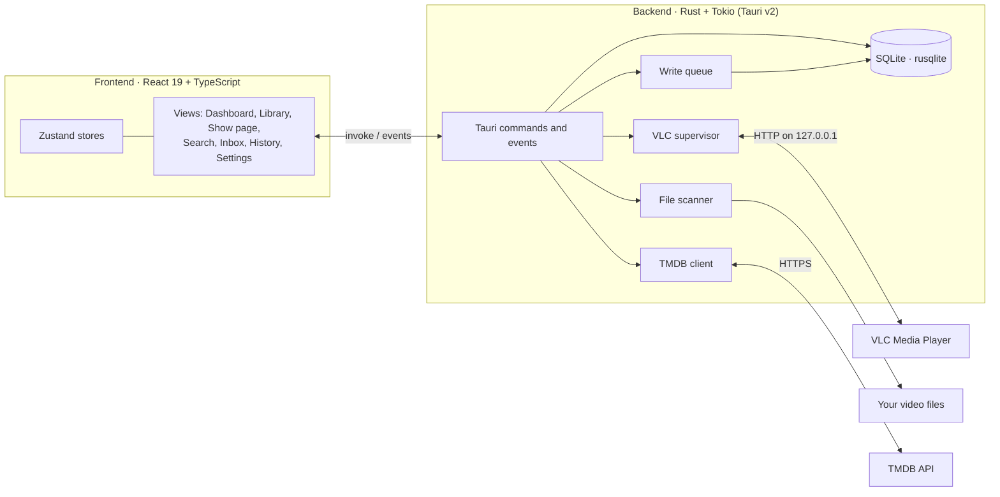

# WatchMark

<div align="center">

[](https://github.com/Headhunte-121/Watchmark/releases/latest)
[](https://tauri.app/)
[](https://www.rust-lang.org/)
[](https://react.dev/)
[](https://www.typescriptlang.org/)
[](https://www.sqlite.org/)
[](LICENSE)

**A local-first desktop watch tracker for people who play their own video files in VLC.**

[Features](#features) • [Getting started](#getting-started) • [Architecture](#architecture) • [How it was built](#how-it-was-built) • [Limitations](#known-limitations) • [Documentation](docs/README.md)

</div>

---

## About the project

WatchMark is a student project: a Windows desktop app that keeps a diary of what you watch in **VLC Media Player**. It launches VLC for you, follows playback through VLC's local HTTP interface, remembers where you stopped, and marks episodes as watched when you finish them. Show and movie details come from [The Movie Database (TMDB)](https://www.themoviedb.org/), and everything is stored in a local SQLite database on your machine.

I built it because I watch a lot of locally stored shows and lectures and kept losing track of where I was. Media servers such as Plex or Jellyfin solve that, but they run as always-on services and are far more than I needed. WatchMark only runs while it's open and needs no server or account.

The project was also a way to learn desktop application engineering end to end: a Rust backend, a React frontend, inter-process communication, a relational schema that evolves over time, and supervising an external process. It was developed between March and November 2026 with AI coding assistants under my direction; [How it was built](#how-it-was-built) explains how that worked and where it went wrong.

| | |
| :--- | :--- |
| **Status** | Active student project. Latest release: [v1.2.1](https://github.com/Headhunte-121/Watchmark/releases/latest) |
| **Platform** | Windows 10 / 11 (the only platform tested) |
| **Size** | About 11,000 lines of Rust, 8,000 lines of TypeScript, 90 Rust unit tests |
| **License** | MIT |

---

## Features

### Playback tracking with VLC
- Launches VLC on the episode's file and resumes from the last saved position.
- Follows playback through VLC's HTTP interface, bound to `127.0.0.1` on the first free port between 8080 and 8090 with a random per-session password.
- Marks an episode **Completed** once you've watched 90% of it (for clips under five minutes, everything except the last 30 seconds). Otherwise it saves your position so you can resume.
- Ignores accidental launches: a play shorter than 5% of the episode is discarded rather than recorded.

### Library and metadata
- Search TMDB for shows and movies and add them to your library.
- Fetches seasons, episodes, air dates, synopses, ratings, posters, backdrops and episode stills, and caches the images locally so the library still looks right offline.
- A background check after launch picks up new seasons, newly scheduled episodes and changed air dates for shows you track.
- Dashboard with a resume-focused spotlight, Continue Watching, Recently Added, Upcoming Airings and New Season alerts.
- Personal 0–10 ratings, separate from the TMDB score.

### Local files and the Inbox
- Scans folders recursively and matches files to episodes from common naming patterns (`S01E02`, `1x02`, anime-style release names, multi-episode files).
- Handles Windows long paths, `.lnk` shortcuts and symlink loops, and skips hidden and partially downloaded files.
- Files it can't match go to an **Inbox**, grouped by guessed title, where you match a whole group in one click or map files to episodes by hand.

### Watch history
- A timeline grouped by day, with consecutive episodes of the same show collapsed into binge sessions.
- Each play shows when you watched it, how far you got, and how long after airing you watched it.
- Filter by TV or movies, remove individual plays or whole sessions (with undo), or clear the history.

### Your data
- Everything lives in one SQLite database under `%LOCALAPPDATA%\WatchMark`, using write-ahead logging.
- Automatic daily backups with SHA-256 checksum files and a configurable number of kept copies, plus manual export, restore and database optimization from Settings.
- The TMDB API key is stored in Windows Credential Manager, not in a plain-text settings file.

---

## Getting started

### Install a release
1. Download `WatchMark_<version>_x64-setup.exe` from the [latest release](https://github.com/Headhunte-121/Watchmark/releases/latest) and run it. It installs for the current user, so no administrator prompt.
2. Install [VLC Media Player](https://www.videolan.org/vlc/) if you don't have it, then set its location in **Settings → General**. **Restore Default** finds a standard VLC install automatically.
3. Get a free TMDB API key ([TMDB account settings → API](https://www.themoviedb.org/settings/api)) and enter it in **Settings → General**.
4. Search for a show, add it, then scan the folder that holds its files.

Each release also includes an MSI installer, a standalone `WatchMark.exe`, and a `SHA256SUMS.txt` you can use to verify the downloads.

### Build from source
Requirements: Node.js 20 or later, the Rust toolchain (stable), and the Microsoft C++ Build Tools that Tauri needs on Windows.

```bash
git clone https://github.com/Headhunte-121/Watchmark.git
cd Watchmark/watchmark-tauri
npm install
npm run tauri dev
```

`npm run tauri build` produces the release executable and installers in `watchmark-tauri/src-tauri/target/release/`. See [Local development](docs/dev/LOCAL_DEVELOPMENT.md) for logs, data locations and troubleshooting.

---

## Architecture



| Layer | Technology | Why |
| :--- | :--- | :--- |
| Desktop shell | Tauri v2 | Small installer and native windowing using the system WebView2 instead of bundling Chromium. |
| Backend | Rust 2021, Tokio | Type and memory safety for file, process and database work; async I/O for polling VLC and calling TMDB. |
| Frontend | React 19, TypeScript, Vite | Typed components; fast rebuilds during development. |
| Styling | Tailwind CSS, Framer Motion | Consistent dark design tokens and view transitions, with reduced-motion support. |
| State | Zustand | Small global stores for settings, background tasks and cached views. |
| Storage | SQLite via rusqlite (WAL mode) | A single local file that handles concurrent reads well and needs no server. |

More detail: [System design](docs/architecture/SYSTEM_DESIGN.md) and [Database schema](docs/architecture/DATABASE_SCHEMA.md).

### Repository layout

```text
watchmark-tauri/
├── src/                 React frontend (components, stores, hooks, utilities)
└── src-tauri/
    ├── src/             Rust backend (commands, db, vlc, scanner, tmdb, backup, ...)
    ├── capabilities/    Tauri permission configuration
    └── tauri.conf.json  App and installer configuration
docs/                    Architecture, development and testing documentation
```

---

## How it was built

WatchMark was written with AI coding agents doing most of the typing, while I set the direction, broke the work down and reviewed the results. Roughly:

1. **Plan in small pieces.** I split the app into areas (storage, VLC tracking, scanning, metadata, UI) and then into small, individually testable tasks, each tracked as an issue.
2. **One task at a time.** Each task was handed to an agent with explicit rules ([`AGENTS.md`](AGENTS.md)): where code lives, which project patterns to follow, and that the code must compile before a task counts as done.
3. **Review and test by hand.** I read the diffs, ran the app on my own machine, and checked behaviour with Task Manager, the WebView DevTools and the SQLite database itself.

What worked well: the Rust compiler and TypeScript's type checker catch a lot of agent mistakes immediately, and small tasks kept changes reviewable. What didn't: "it compiles" is not "it works". Several real bugs survived because nothing exercised them end to end. One example: a database update in the playback tracker that compared a number with a date string, so watch progress was never saved. The [development process](docs/dev/DEVELOPMENT_PROCESS.md) page covers the workflow and these lessons in more detail.

---

## Testing

- **Rust unit tests** (90) cover the database layer, migrations, backups and restore, filename parsing, input sanitization, the task queue and parts of the TMDB client. Run them with `cargo test` in `watchmark-tauri/src-tauri`.
- **Type checking** with `cargo check` and `tsc` runs on every change, and in CI on GitHub Actions.
- **Manual testing** on Windows 11 covers the parts that are hard to unit test: VLC playback, the UI and real media folders.

There are no automated frontend or end-to-end tests yet. See [Testing](docs/testing/TESTING.md) for what is and isn't covered.

---

## Known limitations

- **Windows only.** Some code is written to compile elsewhere, but only Windows 10/11 has been built and tested.
- **VLC only.** Tracking depends on VLC's HTTP interface; other players aren't supported.
- **Needs TMDB.** Adding shows and refreshing metadata require a TMDB API key and a network that can reach TMDB. Some internet providers (for example Jio) block TMDB. WatchMark detects this and suggests Cloudflare WARP or 1.1.1.1 DNS, which usually fixes it. Already-added shows, history, playback and cached artwork keep working either way.
- **Older watch history.** Plays recorded before v1.2.1 have no saved progress because of a bug fixed in that release.
- **Open issues** from a code audit are tracked for upcoming releases, including the TV and movie libraries loading only their first 50 items and a too-permissive local file access configuration.

---

## Roadmap

| Version | Focus | Status |
| :--- | :--- | :--- |
| v1.0 | Core architecture, SQLite storage, VLC tracking | Released |
| v1.1 | Folder scanner, Inbox, credential storage | Released |
| v1.2 | Dashboard spotlight, history timeline, performance fixes | Released (v1.2.1 is current) |
| v1.3 | Library filtering and sorting, cast and crew details | Planned |
| v1.4 | VLC audio/subtitle track selection, tray mode | Planned |
| v1.5 | Viewing statistics, import/export | Planned |
| v2.0 | Visual refresh, command palette (`Ctrl+K`) | Idea stage |

Details are in [ROADMAP.md](ROADMAP.md) and the [changelog](CHANGELOG.md).

---

## Legal

WatchMark is a personal cataloguing tool for media files you own. It does not host, stream, download or share any media. Metadata and images come from the official TMDB API.

This product uses the TMDB API but is not endorsed or certified by TMDB.

## License and acknowledgements

Released under the [MIT License](LICENSE).

Thanks to [VideoLAN](https://www.videolan.org/) for VLC, [TMDB](https://www.themoviedb.org/) for their API, and the [Tauri](https://tauri.app/) project.
