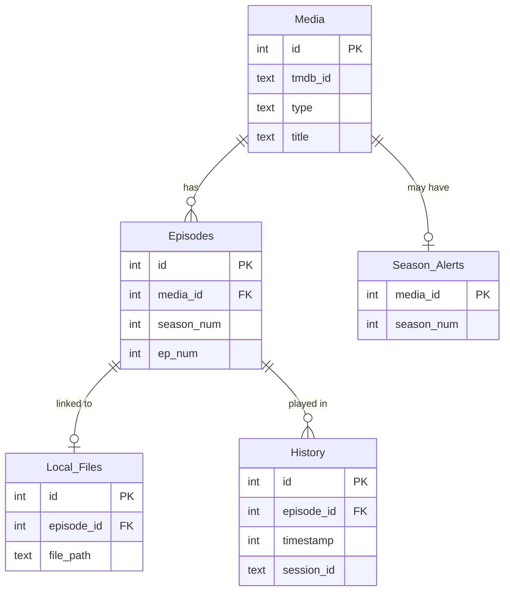

# Database schema

WatchMark keeps all of its data in one SQLite file:

```text
%LOCALAPPDATA%\WatchMark\WatchMark\data\db\watchmark.db
```

The schema is defined and migrated in `watchmark-tauri/src-tauri/src/db.rs`. This page describes schema version **18**.

## Connection settings

Every connection applies:

| Setting | Value | Why |
| :--- | :--- | :--- |
| `journal_mode` | `WAL` | Reads can run while a write is in progress. |
| `synchronous` | `NORMAL` | Safe with WAL, and faster than `FULL`. |
| `foreign_keys` | `ON` | Enforces the relationships below, including cascading deletes. |
| `busy_timeout` | 5000 ms | Waits briefly for a lock instead of failing immediately. |
| `temp_store` | `MEMORY` | Temporary tables and indexes are kept in RAM. |
| `cache_size` | -2000 (≈ 2 MB) | Keeps the page cache small. |

## Relationships



`Unmatched_Files` (the Inbox) and `Collections` (cached movie franchises) are standalone tables.

Deleting a show deletes its episodes, and through them its file links and history, via `ON DELETE CASCADE`. Video files on disk are never deleted.

## Tables

### Media
One row per show or movie in the library.

| Column | Type | Notes |
| :--- | :--- | :--- |
| `id` | INTEGER PK | |
| `tmdb_id` | TEXT | TMDB identifier. Unique together with `type`, since a show and a movie can share an ID. |
| `type` | TEXT | `TV`, `Movie` or `Unknown`. Defaults to `TV`. |
| `title`, `synopsis` | TEXT | Synopsis is capped at 10,000 characters. |
| `poster_path`, `backdrop_path` | TEXT | TMDB image paths. `NULL` when TMDB has none. |
| `backdrop_fallback` | TEXT | `gradient` when neither a backdrop nor a poster exists. |
| `total_episodes`, `status` | INTEGER, TEXT | |
| `vote_average` | REAL | TMDB rating, rounded to one decimal. |
| `user_rating` | INTEGER | Your rating, 0–10. `NULL` means unrated (distinct from 0). |
| `release_date`, `is_exact_date` | TEXT, BOOLEAN | Year-only dates are stored as `YYYY-01-01` with `is_exact_date = 0`. |
| `genres`, `networks` | TEXT | Comma-separated. |
| `collection_id`, `collection_name` | INTEGER, TEXT | Movie franchise, if any. |

### Episodes
One row per episode. Movies get a single virtual episode (season 1, episode 1) so playback and history work the same way for both.

| Column | Type | Notes |
| :--- | :--- | :--- |
| `id` | INTEGER PK | |
| `media_id` | INTEGER FK → Media | `ON DELETE CASCADE` |
| `season_num`, `ep_num` | INTEGER | Both ≥ 0; season 0 is Specials. Unique per show. |
| `title`, `overview`, `season_overview` | TEXT | |
| `runtime` | INTEGER | Minutes. Corrected from the actual file length when they differ by more than 2 minutes. |
| `still_path` | TEXT | |
| `air_date`, `is_exact_date` | TEXT, BOOLEAN | |
| `is_air_date_manual` | BOOLEAN | When set, TMDB refreshes don't overwrite `air_date`. |
| `status` | TEXT | `Unwatched`, `Watching` or `Completed`. |
| `last_position` | INTEGER | Resume position in seconds. Reset to 0 on completion. |
| `watch_count`, `completed_date` | INTEGER, TEXT | |

### Local_Files
Links an episode to a video file on disk.

| Column | Type | Notes |
| :--- | :--- | :--- |
| `id` | INTEGER PK | |
| `episode_id` | INTEGER FK → Episodes | Unique: one file per episode. `ON DELETE CASCADE`. |
| `file_path` | TEXT | Unique. |
| `file_size` | INTEGER | Used to keep the larger file when two match, and to recognise moved files. |
| `file_hash` | TEXT | Sampled hash (start, middle and end of the file) computed before playback. |

### History
One row per play. Indexed on `(timestamp DESC, id DESC)` for the timeline.

| Column | Type | Notes |
| :--- | :--- | :--- |
| `id` | INTEGER PK | |
| `episode_id` | INTEGER FK → Episodes | `ON DELETE CASCADE` |
| `timestamp` | INTEGER | Unix time (UTC) when the play started. |
| `start_time`, `end_time` | DATETIME | Text timestamps from the VLC session. `start_time` is `NULL` for rows created by **Mark season watched**. |
| `session_id` | TEXT | Shared by plays of the same show less than 6 hours apart. |
| `completion_ratio` | REAL | 0.0–1.0, how far this play got. |
| `pause_count` | INTEGER | |
| `is_legacy` | BOOLEAN | Backdated archive entries. |
| `status`, `last_position` | TEXT, INTEGER | Older columns. Some code paths still write them, but the History view reads `completion_ratio` and the episode's own `last_position` instead. |

### Unmatched_Files
The Inbox: files the scanner couldn't match.

| Column | Type | Notes |
| :--- | :--- | :--- |
| `file_path` | TEXT PK | |
| `filename` | TEXT | |
| `parsed_series`, `parsed_season`, `parsed_episode` | TEXT, INTEGER, INTEGER | What the scanner guessed. |
| `group_key` | TEXT | Cleaned show name used to group files in the Inbox. |

### Collections
Cached movie franchise data from TMDB: `id`, `name`, `overview`, `poster_path`, `backdrop_path`, and `parts` (the franchise's movies as JSON).

### Season_Alerts
One row per show with a newly detected season: `media_id` (PK, FK → Media), `season_num`, `dismissed`, `created_at`.

## Indexes

| Index | Purpose |
| :--- | :--- |
| `idx_history_timestamp` on `History(timestamp DESC, id DESC)` | Paging through the history timeline |
| `idx_media_title` on `Media(title)` | Sorting the library by title |
| `idx_media_tmdb_rating` on `Media(vote_average)` | Sorting the library by TMDB rating |

## Migrations

The schema version is stored in SQLite's `PRAGMA user_version`. On startup, `init_db` runs every migration newer than the stored version, in order:

- Each migration runs inside a transaction and bumps `user_version` only after it succeeds. A failed migration rolls back and leaves the database at its previous version.
- Adding a column that already exists (for example after an interrupted upgrade) is tolerated; any other error aborts the migration.
- Changes SQLite can't make with `ALTER TABLE`, such as adding a `UNIQUE` constraint, rebuild the table: create a new table, copy the rows, drop the old one, rename.

Examples of what migrations have done over time: converting History timestamps from text to Unix time, adding `last_position` and resume support, moving user ratings to a nullable 0–10 scale, adding genres, networks and collections, and adding uniqueness constraints on file paths.

## Backups and restore

- **Automatic backups** (once a day) use SQLite's online backup API, which takes a consistent copy while the app keeps running. Each copy is written to `data\backups\watchmark_<date>_<time>.bak`, flushed to disk, and given a `.sha256` checksum file. Older backups beyond the retention limit (default 5) are deleted. A backup is skipped if the drive has less than 10 MB free.
- **Manual export** writes a compacted copy with `VACUUM INTO` to a location you choose.
- **Restore** checks the chosen file (SQLite `integrity_check`, plus its checksum when a `.sha256` file exists), stages it as `watchmark.db.pending`, and restarts. On the next start, before the database is opened, the current file is renamed to `watchmark.db.old` and the staged file takes its place. If the swap fails, the old file is put back.
