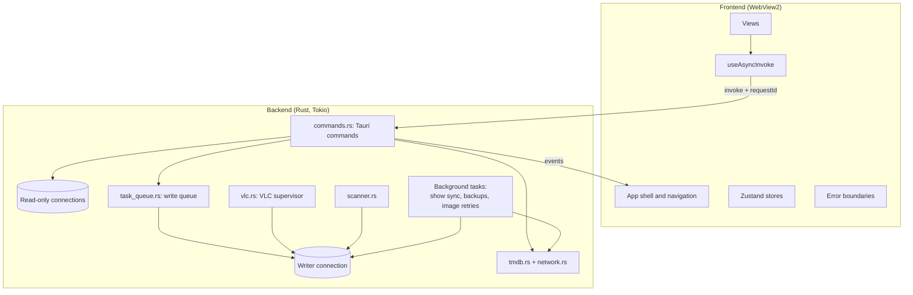

# System design

How WatchMark is structured and why. For behaviour from the user's point of view, see [Features](../FEATURES.md). For the data model, see [Database schema](DATABASE_SCHEMA.md).

## Overview

WatchMark is a [Tauri v2](https://tauri.app/) application. That means two layers in one desktop process tree:

- A **Rust backend** (`watchmark-tauri/src-tauri/src/`) that owns the database, the file system, the network and the VLC child process.
- A **React frontend** (`watchmark-tauri/src/`) rendered by the system's WebView2. It has no direct access to files or the network; it asks the backend through Tauri commands and listens for backend events.

## Backend modules

| Module | Responsibility |
| :--- | :--- |
| `main.rs` | Startup sequence, plugins, tray, global shortcuts, window geometry, shutdown, the `watchmark://` protocol |
| `commands.rs` | Most Tauri commands: library, show pages, dashboard, history, search, inbox, settings, maintenance |
| `db.rs` | Connections, schema creation and migrations |
| `task_queue.rs` | Serialised background write queue with priorities and retries |
| `vlc.rs` | Launching VLC, polling its status, recording progress and completion |
| `scanner.rs` | Folder traversal, file-name parsing and matching |
| `tmdb.rs`, `network.rs` | TMDB API client, image downloads and caching, shared HTTP clients |
| `auto_updater.rs` | Background check of tracked shows for new seasons and episodes |
| `backup.rs` | Automatic backups, checksums and retention |
| `settings.rs`, `models.rs` | Settings persistence (JSON + Windows Credential Manager) and shared data types |
| `sanitizer.rs` | Normalising dates, text and numbers coming from TMDB |
| `filesystem_guard.rs` | Checks at startup that the data folders exist and are readable and writable |
| `logging.rs` | Structured logging with per-module log levels that can change at runtime |
| `error.rs` | The `AppError` type and how errors are serialised to the frontend |

## Startup

1. **Settings** are loaded first so the log level is known. A corrupt settings file is replaced with defaults.
2. **Logging** starts, writing to the console and `WatchMark.log`.
3. **Pending restore:** if a restore was staged in the previous session, the new database is swapped in now, before anything opens it. The old database is kept as `watchmark.db.old`, and the swap is rolled back if it fails.
4. **Tauri** starts with its plugins (dialog, shell, notification, opener, file system, OS, global shortcut).
5. In the setup hook:
   - the window's saved size and position are restored, re-centring it if the saved monitor is gone;
   - the **filesystem guard** checks each data folder by actually reading and writing a probe file, and shows a native error and exits if it can't;
   - the **database** is created or migrated;
   - shared state is registered, and the background tasks, tray and shortcuts are started.

On close, the app asks the write queue to finish pending work and waits up to 2 seconds before exiting, so a write in progress isn't cut off.

## Talking to the frontend

**Commands.** The frontend calls backend functions with `invoke`. Most go through the `useAsyncInvoke` hook, which:
- adds a `requestId` to long-running reads (library, history, dashboard, search) so the backend can cancel them;
- applies a timeout (15 seconds by default);
- ignores results if the component has already unmounted, and tells the backend to cancel the request.

**Events.** The backend pushes events for things that happen asynchronously, for example `vlc-session-ended`, `media-deleted`, `sync-progress`, `scan-match-batch`, `history-changed`, `backup-finished`, `db-write-failed` and `api-auth-failed`.

**Errors** are returned as `AppError`. Network errors are serialised as structured objects (`{ type, code, message }`) so the UI can show a specific message for timeouts, blocked connections or being offline.

## Data access and concurrency

SQLite runs in write-ahead logging (WAL) mode, which lets reads proceed while a write is in progress.

- **Reads** open their own short-lived read-only connection, so a long write never blocks the UI from loading data. Heavy reads run on Tokio's blocking thread pool, limited by a semaphore sized to the CPU count minus one, and check their cancellation token as they go.
- **Writes** go through one shared writer connection. Background and bulk writes are sent to the **write queue**: a dedicated thread with a high-priority channel (user actions such as ratings) and a low-priority channel (bulk work such as deleting a show). Busy-database errors are retried up to 3 times; a permanent failure is logged and reported to the UI.
- **Dashboard statistics** are cached in memory and cleared whenever history or ratings change.

## VLC supervision

`vlc.rs` launches VLC as a child process using Tokio's async process API and then:

1. finds a free port from 8080 to 8090 and generates a random password;
2. starts VLC with its HTTP interface bound to `127.0.0.1` and, when resuming, a start time;
3. records a History row for the play, joining it to the current session if the same show was played in the last 6 hours;
4. waits on two things at once (`tokio::select!`): the process exiting, or the next poll interval. Between polls the task is idle;
5. on each poll, reads VLC's `status.json`, filters impossible values, and updates the saved position on pause, after large jumps or every 5 minutes;
6. when VLC exits, decides between Completed, Watching or a discarded play (see [Features](../FEATURES.md#playback-tracking)), updates the episode and the History row, and emits `vlc-session-ended`.

VLC's console window is hidden on Windows, and a VLC crash is reported to the UI.

## Network access

All external requests go through a shared client in `network.rs`:
- HTTPS only, with rustls (no OpenSSL dependency);
- a 5-second connect timeout and a 15-second overall timeout;
- automatic retries with exponential backoff (up to 3) for transient failures;
- a circuit breaker in front of the retries that fails TMDB requests immediately while TMDB is known to be unreachable;
- a separate local client, without retries, for talking to VLC.

### Connectivity checks

Some internet providers block TMDB while the rest of the internet works, so "offline" and "TMDB blocked" need different advice. A heartbeat in `main.rs` calls `network::check_connectivity()`, which makes three requests in parallel with short timeouts and no retries:

| Request | Answer that counts as success |
| :--- | :--- |
| `https://www.gstatic.com/generate_204` | Any response below 500 |
| `https://1.1.1.1/cdn-cgi/trace` | Any response below 500 |
| `https://api.themoviedb.org/3/configuration` | 200 or 401 (TMDB answers 401 without an API key) |

The result is **Online** (TMDB answered), **TmdbBlocked** (a test site answered but TMDB didn't) or **Offline** (nothing answered). It's stored in one shared value read by the circuit breaker, the background sync and the UI (via the `network-status` event and the `check_connectivity` command).

The heartbeat runs at startup, then every 15 seconds while TMDB is unreachable and every 60 seconds otherwise. A connection error or timeout on a real TMDB request also triggers an immediate re-check. When the status returns to Online, `auto_updater::publish_connectivity` runs any background sync that was deferred and retries failed image downloads.

The app contacts these hosts: the TMDB API, TMDB's image server, the two connectivity test endpoints above, and, on first run only, a public GitLab mirror that hosts the Inter font file used by the UI.

## Frontend structure

| Area | Contents |
| :--- | :--- |
| `App.tsx` | Shell: sidebar, header, view switching, global event listeners, banners |
| `components/` | One component per view (Dashboard, Library, MediaDetails, SearchTMDB, InboxView, History, SettingsView) plus shared pieces |
| `components/history/` | History rows, session cards, types and formatting |
| `components/ui/` | Reusable UI: `SafeImage` (image fallbacks), modals, `ErrorBoundary`, `StarRating`, `VirtualPoster` |
| `store/` | `useAppStore` (settings, cached history), `useTaskStore` (scan and import progress), `uiStore` (modals) |
| `hooks/` | `useAsyncInvoke`, `useHorizontalScroll` |
| `utils/` | Logging (forwarded to the backend log), toasts, image path handling, date formatting |

Each view is wrapped in an error boundary: a rendering error shows a recovery panel for that view, while the sidebar and other views keep working.

## Security notes

What's in place:
- VLC's HTTP interface listens only on the loopback address, with a fresh random password per session.
- The TMDB API key is kept in Windows Credential Manager.
- External network access is HTTPS-only.
- Values that come from the user or TMDB are passed to SQL as bound parameters, not formatted into the query text.
- A Content Security Policy restricts what the WebView can load.

Known weaknesses, recorded for future work:
- The Tauri asset protocol scope and the file-system permissions in `capabilities/default.json` are much broader than needed (they allow reading most of the disk).
- The custom `watchmark://` protocol in `main.rs` will serve any absolute file path, and the frontend doesn't use it. It should be restricted or removed.
- The font is downloaded from a third-party server at first launch without an integrity check.
