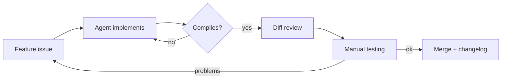

# Development process

WatchMark was built as a student project between March and November 2026 (around 530 commits). Most of the code was written by AI coding agents (Google's Jules and Antigravity, and later Claude Code), with me planning the work, setting the rules, reviewing changes and testing the app. This page explains how that worked, what it got right, and where it fell short.

## Planning

I split the app into six areas, each with clear responsibilities, before writing any code:

| Area | What it covers |
| :--- | :--- |
| App shell | Startup, window, tray, settings, error handling |
| Data | SQLite schema, migrations, backups |
| Playback | Launching and tracking VLC |
| Files | Scanning folders and matching file names |
| Metadata | TMDB search, sync and image caching |
| UI | Views, design system, performance |

Each area was then broken down into small features. Each feature was written up with its expected behaviour and edge cases (for example, "a file name that is only `01.mkv` should take the show name from its folder") and tracked as a GitHub issue under a release milestone.

## Working with coding agents

One feature at a time was handed to an agent, together with a fixed set of rules in [`AGENTS.md`](../../AGENTS.md):

- **Where code goes:** Rust in `watchmark-tauri/src-tauri`, React in `watchmark-tauri/src`.
- **Project patterns:** for example, data-loading commands take a `requestId` so they can be cancelled, and the frontend calls them through the `useAsyncInvoke` hook.
- **Compile before done:** `cargo check` for Rust changes and `npm run build` for frontend changes.
- **Requirement review:** before finishing, the agent re-reads the task, checks each requirement and edge case, and checks it hasn't removed earlier behaviour.
- **Clean history:** conventional commit messages linked to issues, no binaries in the repository, and a user-facing changelog.

I then reviewed the diff, ran the app, and checked behaviour on my own machine with Task Manager, the WebView DevTools and the database.

## What worked

- **The compilers caught a lot.** Rust's type and borrow checker and TypeScript's type checker rejected many incorrect changes immediately, and the agent could fix them without my involvement.
- **Small tasks stayed reviewable.** One feature per task kept diffs small enough to read properly and kept the agent focused.
- **Testing on real hardware found what reviews didn't.** The GPU problem below only showed up in Task Manager while the app was idle.

## What didn't, and what changed

The rules deliberately skipped writing new automated tests, to keep momentum. In practice, "it compiles" turned out to be a much weaker guarantee than it sounded. Bugs that type-checked but didn't work:

| Bug | Why the compiler couldn't catch it | How it was found |
| :--- | :--- | :--- |
| Watch progress never saved: the update compared an integer timestamp column with a date string | SQL inside a string isn't checked by Rust | Inspecting the database: all 616 tracked plays showed 0% |
| The app opened to a blank window: a React hook ran after an early return | Valid TypeScript; it fails only at runtime | The React error in DevTools |
| Watch history stopped after the first page: the page size was compared with a count of grouped cards | The logic was type-correct, just wrong | Comparing the database row count with what the UI showed |
| Two buttons called backend commands that don't exist | Command names are strings | A code audit cross-checking frontend calls against registered commands |
| Column positions shifted after the schema gained columns, breaking queries that used `SELECT *` | Column indexes are runtime values | Empty library and dashboard pages |

Changes this led to:
- **Explicit column lists** in queries instead of `SELECT *`.
- **Error boundaries** in the UI, so one failing view can't blank the whole app, and errors land in the log.
- **Audits that cross-check boundaries** the compilers can't see, such as frontend command names against backend registrations and SQL against the schema.
- **Testing changes against real data** (a copy of the actual database) before releasing.

The project still relies mostly on compile checks and manual testing; see [Testing](../testing/TESTING.md) for the current state and the gaps.

## Case studies

### Idle GPU usage of 70%
- **Symptom:** with animations enabled, the idle Dashboard kept the GPU at about 70% in Task Manager. With animations off it dropped to almost nothing.
- **Cause:** a slow, endless zoom animation on the full-screen backdrop. Because blurred, translucent panels sat on top of it, the browser engine had to redo the blur on every frame.
- **Fix:** the backdrop now fades in once and then stays still, and endlessly pulsing badges were replaced with static styling.
- **Result:** idle GPU usage fell to about 0–1% on my machine.

### Tracking VLC without wasting CPU
- **Problem:** following another program's playback usually means a loop that polls constantly.
- **Approach:** VLC runs as a child process managed by Tokio. The tracking task waits for either the process to exit or the next 5-second poll, and does nothing in between. VLC's HTTP interface is bound to `127.0.0.1` on a free port with a random password per session.
- **Result:** tracking adds no noticeable CPU load while you watch.

### Choosing what to show in the spotlight
- **Problem:** the Dashboard banner used to show a single fixed title.
- **Approach:** each show is scored on several signals: whether you're mid-episode (highest weight), whether a new episode aired in the last two weeks, whether the next episode is a season finale, how recently and how often you've watched it, and whether a local file is available. The top candidates rotate every 8 seconds.
- **Result:** the banner suggests what you're most likely to want next and falls back to the rest of the library when there's no history.

## Tools

- **Coding agents:** Jules and Antigravity for most feature work; Claude Code for later auditing, bug fixing and release work.
- **Verification:** `cargo check`, `cargo test`, `tsc`, GitHub Actions.
- **Manual testing:** Windows Task Manager, WebView2 DevTools, the `sqlite3` CLI.
